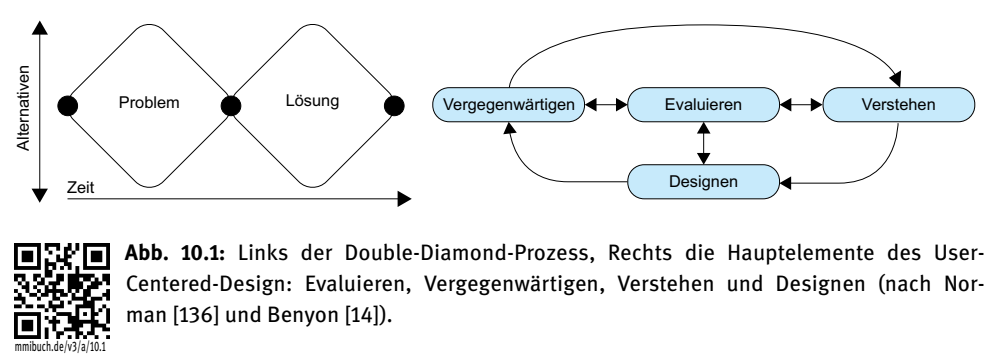

/*

## Forschungsfragen
1.  Wie muss die MFA-Login Webseite gestaltet werden um sowohl sicher als auch benutzerfreundlich zu sein?
2.  Wie verhält sich ein Nicht-IT-Nutzer im MFA Login Workflow? Weiß er immer was zu tun ist? Was fällt ihm negativ auf?
3.  Wie kann der MFA Login Workflow in der UI verbessert werden?
4.  Was muss in der UI getan werden um die Usability Probleme bestmöglich zu lösen?
5.  Wie kann das Design angepasst werden um sicheres Verhalten zu fördern?
6.  Inwieweit sollte das Standard Design angepasst werden, damit sich Benutzer ausreichend sicher verhalten?

## Literaturfragen
1.  Was ist der aktuelle Stand der Forschung im Bereich Usable Security? (Wie hat sich dieser entwickelt?)
2.  Welche Methodiken werden vorgeschlagen?
3.  Gibt es Hinweise, wie ein idealer MFA-Login Workflow und eine MFA-Login Website gestaltet werden müssen (Stichwort Designprinzipien)?

*/

---
---

#### // Aktueller Forschungsstand Einführung
Nachdem zuvor die Forschungsfragen und der Zweck dieser Arbeit festgesetzt wurden, wird im folgenden auf die Grundlagen und den aktuellen Stand der Forschung näher eingegangen, um daraus eine Methodik und weitere wissentschaftlich fundierte Design Prinzipien abzuleiten, nach denen ein Prototyp entwickelt werden kann. Da es sich im Zuge dieser Arbeit um die Überarbeitung einer Anmeldemaske handelt, wird im folgenden kurz auf das Forschungsgebiet der Usable Security und insbesondere auf die dort gängigen Methodiken eingegangen. Diese Methodiken werden dann näher beleuchtet und diskutiert, welche unteranderem auch bei dem Prototyp Design Anwendung fanden. Danach wird, da die Abläufe im MFA Workflow überarbeitet werden sollen, auf Forschung im Bereich MFA im Kapitel so-und-so eingegangen.

# x Grundlagen der UI Gestaltung
// MCI Buch 
- Entwurf von Benutzerschnittstellen geprägt durch Informatiker und Ingenieure
    - führte zu Anfang zu nicht besonders benutzerfreundlichen Systemen
    - Benutzerschnittstelle oft nachrangig behandelt
- => moderne Entwicklungsansansätze betrachten Usability als gleichwertiges oder sogar entscheiodendes Element im Design
- Dix et al. definieren Design als < Quelle >
    - "Ziele unter Berücksichtigung von Einschränkungen"
    - Ziele beschreiben, was mit dem Design erreicht werden soll, in welchem Kontext und von welchen Benutzern es benutzt wird
    - Design immer Beschränkungen unterworfen
        - => Kompromisse

## Mentales Modell
// MCI Buch
- *mentales Modell* als in menschlicher Vorstellung existierende Abbild eines realen Objektes, Systems oder Vorgangs
- Menschen machen bei der Bedienung von Geräten oder Systemen sich ein gewisses Bild davon im Kopf
    - veruchen Vorhersagen darüber zu treffen, welche Eingabe zu welcher Reaktion führt
    - System, das solche Vorhersagen erfüllt erscheint logisch
    - System, das solche Voerhersagen nicht erfüllt scheint unlogisch und verwirrend
        - objektiv unlogisches Verhalten oder Vorhersagen beruhen auf falschen Annahmen
---
- *implementiertes Modell* als detailertes Modell der tatsächlichen Funktionsweise eines Gerätes oder Systems
    - => wird von dem Entwickler entwickelt
---
- *präsentiertes Modell* als die Art und Weise, wie sich das Systems dem Nutzer darstellt
---
- *konzeptuelles Modell* als mentales Modell der Designer, die das System entwerfen
    - haben auch ein mentales Modell von der Bedinung des Systems im Kopf
    - spiegelt sich im präsentierten Modell wieder

###  Transparenz
// MCI Buch
- wünschenswerte Eigenschaft eines Systems stellt Transparenz in der Benutzerschnittstelle dar, wo es darum geht das konzeptuelle Modell des Designers möglichst identisch mit dem mentalem Modell des Benutzers zu halten
    - wird oft nicht erreicht, da präsentierte Modell nicht alle Aspekte wiedergibt und falsch oder nicht vollständig verstanden wird

### x Flexibilität
// MCI Buch
- *Flexibilität* als wünschenswerte Eigenschaft 
    - heißt, das das selbe Ergebnis innerhalb der UI auf verschiedenen wegen erreicht werden kann
        - Unterstützung meherer mentaler Modelle
    - einfaches Beispiel: Tastaturkürzel
        - visuelle Lösungsmöglichkeiten für Einsteiger
        - Tastenkürzel wie z.B. Str+C für fortgeschrittene Nutzer
            - erlernen Kürzel ggf. mit der Zeit wenn UI häufiger benutzt

### x Affordances
// MCI Buch
- Eigenschaft eines Objektes uns für bestimmte Aktionen bzw. Interaktionen damit einzuladen bzw. aufzufordern
    - GUI immer visuell klar erkenne lassen, welche Operationen möglich sind
    - Beispiel: 3D angedeutet Interaktionsschaltflächen -> Buttons
        - heben sich plastisch, visuell 3 dimensonal von der Bildschirmebene hervor
        - ähneln bereits bekannten Druckknöpfen aus der echten Welt

### x Constraints
// MCI Buch
- Affordances + Constraints reichen alleine nicht aus die Bedienung unmossverständlich zu vermitteln
- Einschränkung der Interaktionsmöglichkeiten
- Arten von Constraints:
    - *kulturelle Constraint* als Zuordnung/Einschränkung, die in einem gewissen Kulturkreis verbreitet ist
    - *logische Constraints* als z.B. das ein Licht nicht gleichzeitig an- und ausgeschaltet sein kann

### x Mappings
// MCI Buch
- Zuordnung von Bedienelementen zu Objekten
    - räumlisches Mapping erzeugt Zuordnung durch räumliche Anordnung
    - mögliches Räumlisches Mapping, anstatt mit Beschriftungen zu mappen vorzuziehen
- Verletzung von Mappings machen GUI schwieriger zu bedienen und führen zu vermehrten Eingabefehlern

### x Konsistenz
// MCI Buch
- *Konsistenz* erlaubt das Vorhandensein + Funktion bestimmter Bedienelelemente vorherzusagen und in verschiedenen Kontexten wiederzufinden
- *Syntaktische Konsistenz*: Tatsache, dass Dinge immer strukturell (also syntaktisch) gleich funktioniert.
    - Beispiel: Buttons mit gleicher Funktion immer an gleicher Stelle
- *Semantische Konsistenz*: Kontrollelemente, das in verschiedenen Kontexten ach immer die gleiche Funktion (also Bedeuting oder Semantik) besitzt
    - immer gleiche Verwendung von Farben
- *Terminologische Konsistenz*: gleiche Funktion wird immer mit dem gleichen Begriff benannt
- *innerer Konsistenz*: Konsistenz innerhalb einer einzelnen Anwendung
- *äußere Konsistenz*: Konsistenz über verschiedene Anwendungen hinweg

### x Feedback und Fehler
// MCI Buch
- Bereitstellung von passendem Feedback: System liefert eine Rückmeldung und signalisiert, dass eine Aktion tatsächlich ausgeführt wurde
- helfen zu verstehen in welchem Zustand das System sich befindet und was es gerade macht
    - prägen das mentale Modell
- Beispiel: Sanduhr Cursor oder Fortschrittsbalken zeigt, dass System nicht abgestürzt ist, sondern Aktion länger andauert und noch immer ausgeführt wird
- müssen immer verständlich sein und im Kontext sinnvoll sein
    - müssen zum mentalem Modell passen
- wenn Feedback zu lange dauert, wird es nicht mehr mit der ausgeführten Handlung mental verknüpft
    - Rückmeldung wird für sich alleine interpretiert und die ursprüngliche Operation blieb unbeantwortet
- => Antwortzeiten des Systems minimieren

### x Fitts' Law und Steering Law
// MCI Buch
- Zeit von Mausbewegungen auf dem Bildschirm abschätzen -> Interaktion soll so schnell wie möglich gestaltet sein
    - *Fitts' Law* beschreibt die zeitliche Abschätzung einer eindimensionalen Mausbewegung auf dem Bildschirm abhängig von einer Distanz D von Startpunkt zum Mittelpunkt und einer Breite der des zu treffenden Bereichs in Bewegungsrichtung
    - viele Zeige- und Menütechniken dadurch inspiriert -> z.B. Schaltflächen in Bewegungsrichtung möglichst groß machen insbesondere, wenn sie schnell ausgewählt werden sollen
    - *Steering Law* beschreibt die zeitliche Abschätzung einer Mauswewegung, die einen bestimmten nicht zwingend eindimensionalen Pfad verfolgt, dessen Außengrenzen nicht überschritten werden darf
        - im Allg. anwendbar für das Zeichnen von Kurven
        -> z.B. verschachtelte Menüs nicht unnötig breit gestalten + Einträge so hoch wie möglich

- => decken zusammen einen breiten Bereich der Interaktion in grafischen Benutzerschnittstellebn ab

=> mit Beschriftung bzw. Zeichung

### x Fehler
// MCI Buch
- *gulf of execution* als Kluft zwischen dem angestrebten Ziel und der korrekten Ausführung von Aktionen
    - alles was die Erkennbarkeit der richtigen Aktionen + deren korrekte Ausführung behindert verbreitert diese Kluft
- *gulf of evaluation* als Kluft zwiwschen den Ausgaben un der korrekten Interpretation/Bewertung des Systems
    - unvollständige, irreführende Fehler- oder Statusmeldungen sind Beispiele, die diese Kluft verbreitern
- => gutes Interaktiondesign versucht Kluft zu minimieren
---
// MCI Buch
- Don Norman + James untertscheiden zwei grundlegende Arten von Fehlern:
    1. Irrtümer: beruhen darauf, dass zur Erreichung eines Zeils tatsächlich die falsche Handlung ausgewählt wurde
        - hängen mit fehlerhaften mentalen Modell zusammen
            - Wissenslücken und fehlende Erfahrung als mögl. Gründe
        - Beispiel: Denken, man könnte Feuer mit Spiritus löschen
    2. Fehlleistungen: Handlung zwar korrekt geplant, aber falsch ausgeführt
        - wesentlich Variantenreicher, ein paar davon dargestellt:
            - *Fangfehler*: treten auf, wenn ein oft ausgeführter und vertrauter Handlungsbaluf einen anderen, seltener praktizierten, aber gleich beginnenden Ablauf übernimmt
                - => Änderung der ausgeführten Aktion
            - *Beschreibungs-* oder *Ähnlichkeitsfehler*: treten auf wenn zwei Objekte, Handlungsabläufe sehr ähnlich sind oder nahe beinander liegen
            - *Fehler durch Aktivierungsverlust*: treten auf wenn z.B. bei einem langen Handlungsablauf das Ziel dieser Aktionen vergessen wird
            - ...

### x Fehlervermeidung
// MCI Buch
- System sollte mit Fehlern sinnvoll umgehen und nicht abstützen oder einfrieren
- konsequente Validierung der Eingaben trägt zur Fehlervermidung bei
    - baut ein logisches Constraint ein
- Affordances, Constraints, Mappings, Konsistenz und Feedback tragen alle zur Fehlervermidung bei:
    - Affordances signalisieren korrekte Bedienung
    - Constraints verhindern falsche Eingabe
    - Mapping, Konsistenz und Feedback erhöhen Verständlichkeit von Bedienelementen und Funktionalitäten

### x Fehlermeldungen
// MCI Buch
- andere Form von Feedback
    - Honweise beinhalten müssen, wie man den Fehler beheben könnte
---
- Wo sollten Fehlermeldungen platziert sein?

# MCI Techniken
In dem allgemeinerem Forschungsgebiet der MCI, wird sich auf das Design von Computer Technologien und deren Interaktion mit Anwendern konzentriert. Ursprünglich befasste sich MCI nur mit Computern, umfasst aber heutzutage alle Formen von Informationstechnologiedesigns [<a href="https://www.interaction-design.org/literature/topics/human-computer-interaction?srsltid=AfmBOopdlxI4V6By_PiDVSq0h3ZhlYBiUk6ocmxI5oxxTaJyucZFFyRK">Def. MCI</a>].

## Usability und User Experience
// MCI Buch
- beschreibt die Bedienbarkeit eines Systems
- im deutschen Kulturkreis in einer Norm, der DIN EN ISO 9241-11 festgehalten [DIN Norm]:
    - "Usability ist das Ausmaß, in dem ein Prosukt durch bestimmte Benutzer in einem bestimmten Nutzungskontext genutzt werden kann, um bestimmte Ziele effektiv, effizient und zufriedenstellen zu erreichen."
- muss immer im Bezug auf eine bestimmte Aufgabe, eine klar umrissende Benutzergruppe und einen bestimmten Nutzungskontext bewerten
- besteht aus drei Unterkategorien:
    1. *Effektivität*: System effektiv, wenn es erlaubt eine gestellte Aufgabe zu lösen
    2. *Effizienz*: In welcher Zeit oder mit welchem Aufwand wurde die Aufgabe gelöst
    3. *Zufriedenstellung (Satisfaction)*: wird definiert als "Freiheit von Beeinträchtigung und positive Einstellung gegenüber der Nutzung des Produkts." [DIN Norm]
    - ---
- *User Experience* beschreibt das ganzheitliche Erleben bei der Interaktion
    - Nielsen Norman Group definiert UX als [NNg]:
        - "all aspects of the end-user's interaction with the company, its services, and its products."

## User-Centered Design
Zeix, die Agentur für User Centered Design definiert den Begriff User-Centered Design (UCD)
- "als eine Methode, bei der die Benutzer (User) von Anfang an einbezogen werden. Dadurch wird sichergestellt, dass der Aufbau, der Inhalt und das Design des Endproduklts massgeblich von den Bedürfnissen, Erwartungen und dem Verständnis der User gesteuert werden." (<a href="https://zeix.com/magazin/user-centered-design-in-sieben-punkten-kurz-erklart">Def. User-Centered Design</a>)

// MCI Buch
- Entscheidend ist dabei das Wissen, um die Bedürfnisse und Ziele der Benutzer
    - können sich von den ursprünglichen Annahmen der Entwickler unterscheiden
    - => frühe + umfassende Einbindung der zukünftigen Benutzer
- Designprozess teilt sich in zwei Phasen: Zu Beginn Alternativen exploriert und dann anschließend wieder konsolidiert und das jeweils pro Phase:
    1. *Verständnis der Problemdomäne*
    2. *Erarbeiten von Lösungen*
    - => ergibt ein *Double-Diamond* Schaubild mit #Alternativen auf der y-Achse und den Zeitverlauf auf der x-Achse
- => Eploration + Konsolidierung der beiden Hälften des *Double-Diamond*  erfolgt dabei einem bestimmten Prozesses (siehe Abbildung) und dieser wird als User Centered Design
- Hauptelemente des UCD sind *Verstehen*, *Vergegenwärtigen*, *Evaluieren* und *Designen*
- iterativer Prozess
    - erster Entwurf muss nach dem ersten Durchlauf wieder verbessert werden, erst nach mehreren Iterarionen steht ein zufriedenstellendes Endprodukt
    - => diese Arbeit umfasst nur eine Iteration
- am Ende folgt die Implementierung, die Umsetzung des letzten Designvorschlags

### x Verstehen
// MCI Buch
- Verständnis der Beschränkungen des Designprozesses von großer Bedeutung
    - Verständnis der technischen und menschlichen Beschränkungen 
- Erkennen + Verstehen was die Bedürfnisse der zukünftigen Benutzer aka. Benutzeranforderungen sind, sowie in welchem Kontext aka. Benutzungskontext das Endprodukt verwendet wird
    - beteiligte Personengruppen indentifizieren aka. Stakeholder
        - Benutzer oder von Endprodukt betroffene Personen
    - Aktivitäten analysiert werden, die von der Einführung des Produktes betroffen sind
        - häufig müssen Arbeitsprozesse angepasst werden wenn eine neue Software eingeführt wird
- Abwägung der Beschränkungen
- Technische Nebenbedingungen müssen genau berücksichtigt werden

### x Designen
// MCI Buch
- konkreter Vorschlag entwickelt, in denen die Vorerfahrungen miteinfließen
- besteht aus dem konzeptuellen Design und einem konkreten physischen Design
    1. *konzeptuelles Design* mündet in konzeptuelles Modell, welches auf abstrakte Art und Weise beschreibt, welche Aktivitäten und Objeckte im Zusammenhang stehen
        - kann aus einer einfachen Auflistung von Aktivitäten der Benutzer mit realen oder digitalen Objekten bestehen oder formaler durch ein Entity-Relationship Modell beschrieben werden
        - konzeptuelles Modell muss abstrakt genug sein, sodass konkretes physikalisches Design noch offen gelassen wird
        - geht hier nur darum **was** entwickelt, **wer** wird beeinflusst und **welchem** Kontext steht das Design nicht **wie** die Umserzung aussehen mag
        - besonders beim Verständnis der Problemdomäne relevant (linke Seite des DD)
    2. *physisches Design* addressiert Frage der Umsetzung
        - greift das absstrakte konzeptuelle Design auf und transformiert es in einen Designvorschlag
        - nicht endgültig, sondern nur ein Zwischenprodukt, der beim nächsten UCD Schritt benötigt wird

### x Vergegenwärtigen
// MCI Buch
- Vergegenwertigen von Zwischenlösungen oder Designalternativen
    - bilden die Grundlage um im UCD Prozess weiter fortschreiten zu können
- Methodisch keine Grenzen gesetzt:
    - Vielzahl an Werkzeugen bereit, die es erlauben Prototypen zu entwerfen

### x Evaluieren
// MCI Buch
- Evaluation von zentraler Bedeutung
    - jeder Schritt durch einen Evaluationsschritt abgesichert werden
    - manchmal reicht Abstimmung mit dem Arbeitgeber
    - einige Schritte erfordern umfangreiche Bestandsaufnahme und Evaluation im größeren Rahmen von z.B. groß angelegten Benutzerstudien
        - Prototypen häufig in Benutzerstudien untersucht
        - konzeptuelles Design meistens nur mit Aufftraggeber diskutiert

## x Fragebögen
// MCI Buch
- Mittel um strukturiert Informationen von Stakeholdern zu erhalten
    - werden auch häufig in Interviews verwendet
- wichtig der klaren, sorgfältigen Formulierung
    - Befragte kann keine Rückfragen stellen
    - Antworten sollten keinen Spielraum für Interpretationen lassen
        - Beispiel: Bei Frage "Wie oft spielen Sie Computerspiele?" nicht *wenig*, *mäßig* und *oft* (sind individuell) als Antwortmöglichkeiten angeben sondern mit Zeitbezug um vergleichbar zu machen: *täglich*, *wöchentlich* oder *monatlich*
- einfache Verteilung an große Gruppen
- standardisierte Fragebögen zur Messung abstrakter Größen wie Usability (SUS), User Exprience (UX) oder auch kognitive Belastung
    - ---
- beginnen i.d.r mit allg. Fragen zum Hintergrund des Befragten wie z.B. dem Alter, Bildungsniveau und der technischen Expertise
- Prinzipien nach Rogers et al.:
    1. Leichte vor schwere Fragen
    2. Beeinflussungseffekte von Fragen vermeiden: Vorangegange Fragen beeinflussen ggf. nachfolgende Fragen
    3. Erstellung von verschiedenen Versionen: Bei großen erwartenden Unterschieden bei den Antworten z.B. durch das Alter
    4. Klare Fragen stellen
    5. Fragebogen kompakt gestalten
    6. Nur notwendige Fragen stellen
    7. Offene Fragen ans Ende
- Fragebogen vorab in Pilotstudie auf Ermüdungserscheinungen und Reihenfolgeeffekte testen
    - ---
- Einschätzung zu bestimmten Sachverhalten in Bertungsskalen
    - erlauben unterschiedliche Antworten miteinander zu vergleichen
- *Likert-Skala* erfragt persönliche Einschätzung zu einem bestimmten Sachverhalt
    - durch die Antwort wird Grad der Zustimmung gemessen entweder als zahlenskala oder durch eine verbale Skala
    - ungerade Anzahl erlaubt neutrale Aussagen, kann bei Unsicherheit ggf. häufig ausgewählt werden
    - gerade Anzahl veranlasst die Befragten sich für die ein ider andere Seite zu entscheiden
    
- *Semantisches Differenzial* erfragt die Einschätzung mithilfe paarweise bipolar angeordnerter Adjektive
    - adjektive repräsentieren jewiligen Pole eines Spektrums
    - Befragte gibt Einschätzung durch Ankreuzung einer Position zwischen den Adjektiven
    - Reihenfolge sollte ausbalnciert sein, heißt negative + positive Adjektive sollten sich auf jeder Seite abwechseln
    - 7 Zwischenwerte haben sich in der Praxis durchgesetzt

### x SUS
// MCI Buch
- System Usability Scale (SUS)
- Messung der allgemeinen Usability

### x UEQ
// MCI Buch
- zur Evaluation gibt es einige standardisierte Fragebögen, deren Validität, teilweise auch über verschiedene Kulturkreise hinweg, durch ihre Autoren sicher gestellt wurde

## x Interviewtechniken
// MCI Buch
- unterschiedliche Typen von Interviews:
    1. *unstrukturierte Interviews*: häufig in frühen UCD Phase geführt und liefern grundlegendes Verständnis von Benutzerkontexten und Benutzerbedürfnissen + Nebenbedingungen zu erfahren
        - ähneln einem Fragebogen
            - Unterschied: Befragte kann Rückfragen zur Klärung von Unklarheiten stellen
            - Benutzer motiviert + wenig Rückfragen => Fragebogen
            - Benutzer wenig motiviert + Wahrscheinlichkeit für Rückfragen groß => strukturiertes Interview
        - Benutzer unfähig neue Bedrüfnisse und Innovationen aktiv zu benennen
        - sehr gut um erste Eindrücke zu sammeln + spezifische Fragen zu beantworten
        - Thema wird grob vergegeben
        - reiches, wertvolles Meinungsbild zu einem Themenbereich
        - Ergebnisse schwer zu vergleichen
    2. *strukturierte Interviews*: Menge an vordefinierten, *geschlossenen Fragestellungen*
        - geschlossen heißt, die Antworten sind vordefiniert
        - alle Fragen gleich zu stellen
        - Vergleichbarkeit der Antworten gewährleistet
    3. *semi-strukturierte Interviews*: kombinieren Elemente von beiden und bilden somit einen Kompromiss
        - Erstellung eines Frageskriptes
        - Beinhalten auch offene Fragen
            - sollten so gestellt sein, dass die Antwort des Befragten nicht beeinflusst wird

### Coding und Grounded Theory
// MCI Buch
- Ergebnisse aus unstrukturierten Interviews oder Beobachtungen in eine gewisse Struktur bringen um wissentschaftliche haltbare, publizierbare Aussagen daraus zu gewinnen
    - mit den Methoden der grounded theory erreichen
        - in Interviews aufgetretenen Aussagen und Themen kategorisiert und zueinander in Beziehung gesetzt
        1. *open coding*: einzelne Aussgane bestimmten Themen oder Kategorien zuordnen
        2. *axial coding*: Verbindungen zwischen den einzelnen Kategorien herstellen
            - Geflecht von untereinander verbundenen Kategorien entsteht
        3. *selective coding*: Auswahl eines Hauptthemas, zu dem alle anderen in Beziehung stehen und das die Basis der aus den Daten abgeleiteten Theorie bilden
    - ---
- Mögliche Programme, womit dies umgesetzt werden können sind:
    1. <a href="https://www.maxqda.com/de/">MAXQDA</a>: als Programm für die qualitative Analyse, liefert fortgeschrittene Werkzeuge für Codierung, Retrieval, Transkription und Visualiserung
        - kostet Geld, ist nicht kostenlos
    2. <a href="https://qualcoder.wordpress.com/reports/">QualCoder</a>: als kostenlose OpenSource Software für die qualitative Datenanalyse

## x Prototypen und Skizzen
### Skizzen
// MCI Buch
- Skizzen oft in frühen Konzeptionsphasen erstellt
    - entahlten bzw. fokussieren sich nur auf die wesentlichen Inhalte
    - zeigen oft die Idee oder das Konzept für ein späteres detailreicheres Werk
    - schnell und einfach anzufertigen
    - sind zum Wegwerfen gemacht

### Prototypen
// MCI Buch
- in späteren Phasen mehr oder weniger funktionale Prototypen evaluieren
- Prototypen treffen bestimmte, klare Aussagen zu einem Entwurf oder einer Konstruktion
    - setzt bestimmte Teile der Funktionalität eines geplanten Produktes oder Systems so um, dass diese Teile ausprobiert werden können
- *Auflösung* beschreibt den Umfang der Umsetzung und bezeichnet umgangsprachlich eher den Funktionsumfang
- *Detailgenauigkeit* beschreibt, wie nahe der Prototyp am geplanten System ist
- Auflösung und Detailgenauigkeit eines Prototypen entscheiden darüber für welche Art von Feedback er geeignet ist
    - grafisch detailiertere Prototypen liefern Meinung zu seiner Gestaltung in Aspekten wie Farben, Schriften, Wortwahl
    - grafisch nicht ausgestaltet, dafür aber funktionell ausgestaltet Prototyoen liefern mehr Antworten zur logischen Struktur der Bedienabläufe
    - ---
- zwei Arten von Prototypen:
    1. *horizontale Prototypen*: jede Funktion ist vorhanden im Menü, aber keine ist detailiert ausgearbeitet
    2. *vertikale Prototypen*: Oberfläche nicht vollständig, dafür eine Funktion ist konkret in die Tiefe ausgearbeitet

#### Beispiel: Papier Prototypen
- Papier Prototypen häufig verwendet
    - bestehen aus mehr oder weniger detaillierten Zeichnungen geplanter Bildschriminhalte
    - Evaluation + Simulation mit Benutzer stellt seht stark die eigentlichen Bedienabläufe in den Vordergrund
        - konkrete grafische Umsetzung wird in den Hintergrund gestellt

### Wireframes
// Wireframe Webseite
- Wireframe als vereinfachtes, schematsiches Layout einer Webseite, App oder Benutzeroberfläche, das die grundlegende Struktur und Anordnung der Elemente darstellt
    - i.d.r. keine detaillierten visuellen Gestaltungen mit Farben, Bilder oder Typograpfie
    - konzentration auf Funktionalität und Positionierung
    - schnelle und effiziente Methode um Struktur einer UI zu visualisieren und zu testen
- Zwecke:
    - helfen eine intuitive, logische Struktur zu entwickeln
    - Positionierung von Inhalten und Funktionen optimieren
    - Frühzeitiges Feedback
- Arten von Wireframes:
    1. *Low-Fidelity-Wireframes*: sehr einfach gehalten, enthält nur grundlegende Blöcke und Platzhalter für Inhalte
        - für frühe Phasen geeignet
        - oft handgezeichnet
        - Papierprototypen zählen auch dazu
    2. *Mid-Fidelity-Wireframes*: mehr Details enthalten, bieten bessere Vorstellung vom Endprodukt
    3. *High-Fidelity-Wireframes*: sehr detailiert
        - entahlten oft Texte und deren präzise Platzierung

// Wireframing Essentials
- wireframes sind die grundlegeden Blaupausen einer Oberfläche, die die Kernfunktionalitäten abdecken
    - sind i.d.r. detailierter als Papier Prototypoen und können interaktiv sein
    - geben je nach detailgrad eine Skelettansicht eines Produkts
        - im Anfang, wenn noch kein Design vorhanden ist, detailgrad gering
            - werden oft Plathalterboxen platziert für Designelemente, die noch nicht angegangen wurden
                - konzentration auf die ausgewählte Hauptfunktionalität
        - wenn bestehendes Design verbessert werden soll, dann ist es einfacher, Design kann im Prototypen wiederverwendet werden

#### Balsamiq und Figma als mögliche Wireframe Programme
1. Balsamiq: ist ein *low-fidelity wireframing tool*, welches schnell und informelle visuelle Repräsentationen von jeglichen Software UI's erstellen kann
    - optimiert design ideen zu kommunizieren und zu generieren in der frühen Entwicklungsphase einer Software
    - kommt nur mit rudimentären Interaktionsfunktionalitäten
2. Figma: ist ein *high-fidelity-Wireframe*  Prototyping tool
    - ist optimiert for das Erstellen on realistischen Oberflächen und Interkationen, die oft für Usability Testings und Client Presentationen eingesetzt werden
        - sehen aus und fühlen sich an wie das reale Endprodukt
    - sind schneller als echten Code zu schreiben und bieten ein umfassendes, realistisches Benutzererlebnis
    - haben eine steilere Lernkurve und Prototypen dort sind aufwendiger zu Erstellen
        - erlauben Interaktionsdetails, wie Hovering, Animationen und komplexe Interaktionen -> benötigen mehr Zeit unf ggf. komplexe Logik zum Erstellen

# x Grundlagen des Studiendesign
## Quantitativ vs. Qualitativ
// MCI Buch
1. *Quantitative Evaluation*: liefern quantifizierbare, also in Zaheln ausrückbare Ergebnisse
    - Beispiele: Messwerte, Fehlerraten, jegliche numerische Bewertung
    - liefern statistisch auswertbare und damit wissentschaftlich allgemein als belastbar anerkannte Aussagen
2. *Qualitative Evaluationen*: Aussagen, die sich nicht numerisch fassen lassen
    - Beispiele: frei formulierte Kommentare von Probanden in Interviews oder Fragebögen, sowie Beobachtungsnotizen einer Studie
    - runden das Bild einer Studie ab
    - enthalten oft interessante Details und Aspekte

## Analytisch vs. Empirisch
// MCI Buch
1. *Analytische Evaluation*: untersuchen ein System, indem sie das System selber analysieren; dazu gehören Bestandteile, Arbeitsweise oder Eigenschaften; betrachten und erklären diese
    - oft schnell und kostengünstig
2. *Empirische Evaluation*: befassen sich lediglich mit den Ergebnissen bei der Bedienung eines Systems und beachten nicht wie dieses Zustande gekommen ist
    - kontrollierte Experimente als prominentestes Beispiel
    - alle Formen, die durch Messung oder anderweitige Sammlung in Experiementen, Beobachtungen oder Befragungen Daten erheben

## Variablen und Werte
// MCI Buch
- Daten oder Merkmale, die in einer empirischen Untersuchung messen oder einstellen heißen *Variablen*
- *unabhängige Variabeln*: Daten oder Merkmale, die durch die Umgebnung fest vorgegeben oder die als Experimentor kontrolliert und geziehlt eingestellt werden
- *abhängige Variablen*: diejenigen Daten, die als Ergebnis der Untersuchung gemessen werden und vom beobachteten Prozess abhängen
- *Conditions*: beschreiben die experiementellen Bedingungen
    - ergeben sich aus allen möglichen Kombinationen der unabhängigen Variablen
    - werden auf die Probanden verteilt
    - Beispiel: IV Fach (MCI, Analysis, Lineare Algebra) ~ IV Übungsteilnahme (Ja, Nein)
        - **Todo**: Tabelle der Conditions erstellen + erklären

## Between- vs. Within Subjects Design
// MCI Buch
1. *Between Subjects Design*: jeder Proband durchläuft nur eine Condition und man vergeleicht diese über verschiedene Gruppen hinweg
2. *Within Subjects Design*: jeder Proband durchläuft alle Conditions
    - Reihenfolge spielt eine Rolle: Lerneffekte, Ermüdungseffekte
    - Eindämmen durch Variation der Reihenfolge der Conditions

## x Beobachtungsstudien
// MCI Buch
- Beobschtungsstudien einfachste Form empiriischer Studien
- Prozesse werden beobachtet, ohne dass man in ihren Ablauf geziehlt eingreift oder unabhängige Variablen kontrolliert
- Probanden werden verschiedenen Conditions zugeordnet entweder manuell oder automatisch, wenn Condition einer Eigenschaft von Probanden entspricht, wie z.B. Alter oder Geschlecht

// Think Aloud Buch
- eine Klasse an Methoden basieren auf der Beobachtung von Problemlöse Verhalten
    - Problemlöse Verhalten beobachten während es stattfindet
- unstruktierte Technik in dem Sinne, das das Verhalten der Benutzer nicht eingeschränkt wird

### Retrospektion
// Think Aloud Buch
- Teilnehmer löst ein Problem, eine Aufgabe und wird danach darüber befragt über seine Denkprozesse
- kann auch aufgenommen und dem Teilnehmer gezeigt werden dabei
- Teilnehmer tendieren dazu ihre Denkprozesse mehr intelligenter und zusammenhängender darzustellen als sie eigentlich sind
    - tendieren Events mehr strukturiert wiederzugeben als sie eigentlich waren
- Teilnehmer werden nicht alle Gedanken wiedergeben und sogar falsche Erinnerungen wiedergeben
    - es werden nicht alle Gedanken wiedergegeben, die die bei der Problemlösung aufgetreten sind
- Teilnehmer kan Aufgabe ungestört lösen und wird dabei am wenigsten beeinflusst
    - Wissen, das er danach befragt wird, könnte sein Verhalten beeinflussen

### Think Aloud
// NNg
- "Simple usability tests where user think out loud are cheap, robust, flexiböe, and easy to learn"
- Definition: "In a **thinking aloud test**, you ask test participants to use the system while continuously thinking out loud - that is, simply verbalizing their thoughts as they move though the user interface."
    - Simple in Anführungszeichen, da es nicht simpel ist für viele Menschen mit sich einen Monolog aufrechtzuerhalten
- dient als "windown on the soul": Lässt dich entdecken, was Benutzer wirklich denken über das Design
    - hörst deren Miskonzeptionen, welche normalerweise in umsetzbare Designänderungen münden
    - lernst warum Benutzer falsche Vermutungen anstellen und warum sie Fehler begehen
- Vorteile: Cheap, Robust, Flexible
    - **Robust**: auch wenn Studie schlecht ausgeführt immernoch gute Ergebnisse werden gefunden
    - **Flexible**: kann für viele Anwendungszwecke benutzt werden
        - für jede Phase im Entwicklungsprozess mit aller Art interaktiven System anwendbar
- Nachteile: gibt keine detailierten statisken wieder, es sei denn Studie wird auf einer großen Menge an Teilnehmern durchgeführt
    - Situation des Laut denkens unnatürlich -> schwer für manche Monolog aufrechtzuerhalten
    - meisten Leute wollen smart wirken, Risiko, dass sie nicht soviel sprechen

// Think Aloud Buch
- Teilnehmer angewiesen laut zu denken während ein Problem gelöst wird
    - währemd der Studie immer wieder dazu angewiesen
- Teilnehmer soll die ganze Zeit sprechen und jeden einzelnen Gedanken bei der Bearbeitung der Aufgaben laut auszusprechen 
- keine Unterbrechungen durch Prompts und Fragen
- Daten sehr direkt und ohne Verzögerung und Interpretation von Seiten des Teilnehmers
    - muss seine Gedanken nicht sortieren und in eine Form bringen
        - rendert sie sobald sie in den Sinn kommen und spricht sie einfach laut aus
- Teilnehmer wird nicht alle Gedanken verbalisieren
- nicht viele Hinweise, dass lautes Denken, den studierten Effekt großartig beeinflusst
- cognitive process braucht länger wenn laut Gedacht wird

### Introspektion
// Think Aloud Buch
- Teilnehmer anweisen nicht nach Erfüllung der ganzen Aufgabe, sondern immer mal wieder zwischendurch Bericht zu erstatten, die er sich aussuchen darf
    - ermutigt ein akkurates, komplettes und zusammenhängenden Bericht zu geben
    - beinahltet auch wieder Teilnehmers Interpretation

# Usable Security
## Relevanz für Sicherheitsmechanismen
Die Transparenz stellt insbesondere beim Entwurf von Sicherheitsmechanismen eine große Herausforderung dar, da die Sicherheitskonzepte oftmals zu komplex sind um diese im präsentierten Modell darzustellen. Es gibt oftmals keine für Benutzer selbstverständliche mentale Repräsentation, da Sicherheitskonzepte oft zu abstrakt und in der für Benutzer realen Welt nicht erfahrbar sind. \cite{shibsrc_reuter2022quarter}

#### // What is UseCap?
Usable Security ist ein anerkanntes Forschungsgebiet, welches ein Teil der Mensch-Computer Interaktion (MCI) darstellt [8]. 

Die Autoren so-und-so et al. haben die Arbeiten:

1. "User-Centered Security" - Zurko et al. [3]
2. "Users are not the enemy" - Anne Adams et al.[4]
3. und "Why Johnny can't encrypt: A Usability Evaluation of PGP 5.0" - Alam Whitten et al. [5]

als bedeutende Arbeiten aus den 1990er Jahren, die das Forschungsfeld der Usable Security begründet haben eingestuft [8]. Obwohl diese sich zunächst nur auf Passwortsicherheit und E-Mail Sicherheit konzentriert hatten, konnte aufbauend auf den Ergebnissen, das Forschungsgebiet weiter ausgebaut und auf andere Sicherheitskontexte erweitert werden. [8]

#### // (x) UseCap in the very past
Dabei wurde schon lange zuvor festgestellt, dass Benutzerfreundlichkeit in das Design von Sicherheitssystemen miteinbezogen werden sollte. 1888 hat bereits Auguste Kerckhoff dies in seiner Arbeit bei der Definition seiner sogenannten sechs Kerckhoff Prinzipien festgehalten, die sicher stellen sollten, das ein Kryprografie System sicher bleibt auch wenn alles vom System bis auf die Sicherheitsschlüssel öffentlich bekannt ist [8]:

- "6. Lastly, given the circumstances in which it is to be used, the system must be easy to use and should not be stressful to use or require it's users to know and comply with a long list of rules" [1]

Dies lässt sich auch auf allgemeinere Mechanismen verallgemeinern und deckt sich somit auch mit den acht Prinzipien für Sicherheitsmechanismen, die von Jerome H.Saltzer 1975 vorgeschlagen wurden. Er definiert in seiner Arbeit das Prinzip "Psychological acceptability", welches darauf abziehlt, das Benutzerschnittstellen benutzerfreundlich gestaltet werden müssen, damit der entworfene Sicherheitsmechanis von Anwendern intuitiv und automatisch so verwendet werden kann, wie es vorgesehen ist. [2]

#### // UseCap failures
Nichtdestotrotz sind die obigen in der Forschung bekannten Prinzipien beim Entwurf von Sicherheitsmechanismen in den 1990er Jahren vernachlässigt worden, sodass entworfene Sicherheitssysteme ein deutliches Benutzerfreundlichkeitsproblem aufwiesen, welches die ganze Sicherheit der Systeme gefährdet haben.

#### // "Users are not the enemy"
Die Arbeit von Anne Adams im Jahre 1999 mit dem Titel "Users are not the enemy" macht genau auf diesen Umstand im Kontext der Paswortsicherheit aufmerksam. Mit ihrer durchgeführten qualitativen Studie in Form eines webbasierten Fragebogens, wo insgesammt 139 gültige ausgefüllte Fragebögen ausgewertet wurden. Im Allgemeinem konnte ein Kommunikationsproblem zwischen Benutzern und Sicherheitsexperten beim Design damalgiger Sicherheitssysteme festgestellt werden. In dem Schaubild so-und-so wird diese Situation grafisch dargestellt und im folgenden erläutert:

Auf der einen Seite steht der Benutzer, der Sicherheit nicht als primäres Ziel, bei der Erfüllung seiner Aufgaben sieht. Die Sicherheitsmechanismen, die der Benutzer durchlaufen muss, werden oft nicht verstanden bzw. missverstanden, da ein eigenes von der Realität abweicheindes mentales Sicherheitsmodell erstellt wird, welches von der UI und dem mentalem Modell der Benutzer beeinflusst wird. Das Resultat ist, das intuitiv versucht wird die implementierten Sicherheitsmechanismen zu umgehen, welches der Sicherheit des ganzen System schadet. [4]

Auf der anderen Seite dagegen stehen die Sicherheitsexperten, die Sicherheitssysteme entwerfen, die in der Theorie sicher sind, allerdings den Anwender beim Entwurf nicht miteinbeziehen. Experten verstehen oftmals das Verhalten und die Bedürfnisse der Benutzer nicht. Aufgrund dessen intuitiven, unsicheren Verhalten empfinden Experten Anwender als konsequent unsicher und versuchen ihre entworfenen Mechanismen noch weiter zu verschärfen um sicheres Benutzerverhalten zu erzwingen. Sie betrachten den Benutzer somit nicht als Teil des Systems, sondern behandeln ihn als ein Antagonist.

#### // "Why Johnny can't encrypt: A Usability Evaluation of PGP 5.0"
Eine weitere bedeutende Arbeit, die eine Diskrepanz zwischen Benutzerfreundlichkeit und Sicherheit in Sicherheitssystemen festgstellt hat ist die Arbeit von Alam Whitten et al. aus dem Jahre 1999 mit dem Titel "Why Johnny can't encrypt: A Usability Evaluation of PGP 5.0".

Nach der Analyse der grafischen Benutzeroberfläche von PGP 5.0 zur E-Mail Verschlüsselung (siehe Abbildung so-und-so) mittels eine Usability Studie, wurde festgestellt, das nur ein Drittel der Teilnehmer das Programm korrekt bzw. sicher verwenden konnten. Ein Viertel haben sogar den privaten Schlüssel geteilt, der um die Sicherheit des ganzen Systems zu gewährleisten geheim gehalten werden muss.

Dabei wurden 5 Eigenschaften von Sicherheit dargestellt, die für das damalige UI Design ein Problem dargestellt haben.

1. Fehlende Motivation: Viele Anwender haben Sicherheit nicht als primäres Ziel und empfinden dies in der Verantwortung des Systems und erwarten deren Integration. Sie empfinden Maßnahmen zum Schutz des Systems als umständlich und versuchen diese intuitiv zu umgehen.
2. Abstrakte Richtlinien: Sicherheitsrichtlinien bestehen oftmals aus einer Menge an abstrakten Regeln. Die Erstellung und Verwaltung ist für Personen ohne Fachwissen oft kaum nachvollziehbar und schwer anwendbar.
3. Unzureichendes Feedback: Die Notwendigkeit schwerwiegende Fehler zu vermeiden erfordert eine Bereitstellung von hilfreichen und verständlichem Feedback. In Sicherheitskontexten stellt dies jedoch eine große Herausforderung dar, da Warnungen und Feedback oft zu komplex und unverständlich formuliert sind.
4. Unzureichendes Sicherheitsverständnis: Fehlendes oder unzureichendes Verständnis für Schutzmechanismen führt dazu, das Benutzer unbeabsichtigt gravierende Sicherheitsrisiken eingehen ohne davon zu wissen.
5. Schwächtes Glied Problem: Die Gesamtsicherheit eines Systems hängt von seiner anfälligsten komponente ab.

Alam Whitten et al. haben mit ihrer Arbeit auf die Notwendigkeit von Sicherheitsspezifischen UI Design Prinzipien und Techniken aufmerksam gemacht um Systeme sowohl sicher als auch benutzerfreundlich zu gestalten.

Zusammenfassend machen die Arbeiten von Anne Adams und Alam Whitten im allgemeinen auf einen Mangel an User-Centered Design beim Entwurf von Schutzmechanismen und Sicherheitsrelevanten UIs aufmerksam.

#### // User-Centered Design
Zeix, die Agentur für User Centered Design definiert den Begriff User-Centered Design (UCD)

- "als eine Methode, bei der die Benutzer (User) von Anfang an einbezogen werden. Dadurch wird sichergestellt, dass der Aufbau, der Inhalt und das Design des Endproduklts massgeblich von den Bedürfnissen, Erwartungen und dem Verständnis der User gesteuert werden." (<a href="https://zeix.com/magazin/user-centered-design-in-sieben-punkten-kurz-erklart">Def. User-Centered Design</a>)

#### // User-Centered Security
Mit dem Begriff User-Centered Security (UCS) wird im allgemeinen eine Interessensverschiebung beim Entwurf von Sicherheitsmechanismen angesprochen, sodass Usability als primäres Designziel verfolgt wird. Zurko et al. haben bereits 1996 mit ihrer Arbeit "User-Centered Security" UCS definiert:

- "The term _user-centered security_ [...] refer[s] to security models, mechanisms, systems, and software that have usability as a primary motivation or goal." [3]

Dabei wurden bereits drei Kategorien an Möglichkeiten vorhergesehen um UCS in die Praxis umzusetzen [6]:

1. Anwendung von MCI Design- und Test Techniken auf Sicherheitssysteme
2. Bereitstellung von bewährten Sicherheitsmechanismen und -modellen
3. Entwurf von erwünschten oder geforderten Sicherheitsfeatures

#### // User-Centered Security: Stepping Up to the Grand Challenge
Einige Jahre später, in den frühen 2000er Jahren hat sich gezeigt, dass die Anwendung nutzerzentrierter MCI Methoden beim Entwurf von Sicherheitsmechanismen sich bisher als effektivste Methode herausgestellt haben um UCS zu praktizieren [6]. 

Die Anwendung und stetige Integration von nutzerzentrierten MCI Techniken auf den Entwurf von Sicherheitssystemen ist bis heute ein offenes Forschungsfeld geblieben, welches beispielsweise der Workshop "Mensch-Maschine-Interaktion in sicherheitskritischen Systemen" im Rahmen der Konferenz "Mensch und Computer 2024" aufzeigt, wo underanderem "Beiträge zu nutzerorientierten Konzepten der Resilienz technischer Systeme in Bezug auf potenzielle Angriffe (Usable Security)" im Blickpunkt standen [<a href="https://muc2024.mensch-und-computer.de/de/program/workshops/#MCI-WS13_11_Workshop_Mensch-Maschine-Interaktion_in_sicherheitskritischen_Systemen">MUC 2024</a>].

Dies zeigt, dass sich noch keine anerkannten Tools und best practices durchgesetzt haben, obwohl Forschende immer wieder Modelle und Heuristiken entwickelt haben, wie beispielsweise die Arbeiten von Denis Feth et al. [7][9] und Realpe et al. zeigen [A Set of Heuristics for Usable Security and User Authentication], auf dessen Arbeiten ebenfalls in den nächsten Abschnitten eingegangen wird.

Die Herausforderung besteht darin, dass es kein angebrachtes, anerkanntes Modell gibt menschliches Sicherheitsverhalten abstrakt zu modellieren, da solche Modelle ggf. relevante Details wegabstrahieren würden [6].

Zusätzlich wurden vereinzelte Prinzipien wie beispielsweise Integrated Security und Transparent Security festgehalten, die im Abschnitt Design Prinizpien näher erläutert werden.

# Usable Security Prinzipien
// "User-Centered Security: Stepping Up to the Grand Challenge" - Zurko; 2006
- Tradition Sicherheit und Benutzerfreundlichkeit mit Labortest und Echtweltstudien an Echtweltsystemen durchzuführen
    - Sicherheit kann durch beispielsweise "red teaming" < Was ist das? > oder "ethical Hacking" untersucht werden
    - Usability kann getestet werden im Labor, wo Teilnehmer eine Liste an Aufgaben am System oder Prototypen erfüllen müssen; oder durch "contextual analysis" < Was ist das? >; oder durch die Analyse von Log Dateien bzw. Echtweltdaten

## Heuristiken
// Eine der UseCap Quellen, ich denke 09
- Usability Heuristiken reichen für UseCap nicht aus

// 09 "Heuristics and Models for Evaluating the Usability of Security Measures" - Denis Feth et al.; 2019
- ermöglicht eine frühe Benuerfreundlichkeits Evaluation durchzuführen
    - Sicht des Benutzers früh in Entwicklungsprozess berücksichtigen
- Heuristiken für Sicherheit und Benutzerfreundlichkeit aus einem kombiniertem Modell
- best practice Heristiken mit Fokus auf Durchführbarkeit als auf Vollständigkeit

// Ich denke 09
- Heuristic Evaluation nicht gemacht
    - Usability Heuristiken inkludieren Sicherheit nicht
    - Usability + UseCap heuristiken nicht durchführbar, da für viele der Heuristiken zu wenig Informationen über das System bekannt
        - bewerten nicht nur UI

## Integrierte Sicherheit
## Transparente Sicherheit
// 08 "A quarter century of usable security and privacy research: transparency, tailorability and the road ahead" - Christian Reuter et al.; 2022
- Transparenz als große Herausforderung im Entwurf von Sicherheitsmechanismen
    - liefert dem benutzer Sicherheitsrelevante Informationen mittels der UI und hilft dem Benutzer Interventionen/Interaktionen besser zu verstehen
    - sollte sinnvoll aufgeschlüsselt und dargestellt werden
    - black-box approach: Zeigen nur das Ergebnis aber erklären es nicht näher
    - white-box approach: Zeigen auch warum das Ergebnis so ist, wie es ist
        - könnten ggf. Benutzer mit Informationen überfluten
- meiste Ansätze von Transparenz und Benutzerinterventionen zu einheitlich -> oft nicht so effektiv wie gewünscht
    - Trend diese Kontext-sensitiv und benutzerzentriert zu gestalten
        - angepasste nudges, die Hinweise auf die Konsequenzen beinhalten, welches das aktuelle Benutzerverhalten inkludiert, ohne dieses vorzuschreiben
        - viel versprechende Vorteile, trotzdem kaum Anwendung in Cyber Security Contexts
            - [Peer et al., 2019] konnten Erstellung stärkerer Passwörter durch das Personalisieren der Hinweise erzielen
        - => Unterschiede in den Benutzern spielen oftmals eine große Rolle bei Sicherheitsentscheidungen
        - "control oppurtunities" als Alternative zur Personalisierung
            - führt zum "Privacy paradox": mehr wahgenommene Kontrolle fürher zu weniger sicheren bzw. datenschützendem Verhalten

// 09 "Heuristics and Models for Evaluating the Usability of Security Measures" - Denis Feth et al.; 2019
- Transparenz als Basis um für eine individuelle Wahrnehmung

# Authentifizierung
## Authentifizierungs Guidelines
- Angemeldet bleiben Guidelines
- Risikobasierte Authentifizierung (Risk-Based Authentication, RBA)

## Single-Sign-On (SSO)
- Shibboleth erklären im Vergleich zu anderen SSO Softwares? Nur sehr kurz
### Shibboleth
Shibboleth ist eine Open-Source Umsetzung der \acs{SSO} Technologie und eines der weltweit verbreitesten Identitätsmanagementsysteme. Es ist besonders besonders unter akademischen Institutionen, Identitätsverbänden und kommerziellen Organisationen auf der ganzen Welt verbreitet. [<a href="https://www.shibboleth.net/about-us/the-shibboleth-project/">Shibboleth Def.</a>]

## Multi-Faktor-Authentifizierung

## Vorangegange Projektgruppe
- Kategorien an Problemen definieren

---
# Quellen
## // 01 "La Cryptographie Militaire" - Auguste Kerckhoffs; 1888
- Kerckhoffs Prinzipien beinhalten bereits in Prinzip 6, dass Usability des Sicherheitssystem miteinbezogen werden sollte:
    - "6. Lastly, given the circumstances in which it is to be used, the system must be easy to use and should not be stressful to use or require it's users to know and comply with a long list of rules"

## // 02 "The Protection of Information in Computer Systems" - Jerome H. Saltzer et al.; 1975
- "Psychological acceptancy" beschreibt, das UI benutzerfreundlich gestaltet sein muss, damit der entworfene Sicherheitsmechansimuss vom Benutzer intuitiv und automatisch so verwendet wie gewollt.
    - Mentales Bild des Benutzers von Sicherheit muss zum Benutzen Sicherheitsmechanismus passen
    - Teil der 8 Prinzipien für Sicherheitsmechanismen

### // 03 "User-Centered Security" - Zurko et al.; 1996
- Definition von User-Centered Security:
    - "Refer\[s\] to security models, mechanisms, systems, and software that have usability as a primary motivation or goal."
- drei Kategorien an Lösungsmöglichkeiten vorhergesehen:
    1. HCI Design und Test Techniken
    2. Bereitstellen von Sicherheitsmechanismen und -modelle für Software zur menschlichen Zusammenarbeit
    3. Designen von direkt erwünschten, geforderten Sicherheitsfeatures von Seiten der Benutzer

## // 04 "Users are not the enemy" - Anne Adams et al.; 1999
- Benutzerfreundlichkeit von Sicherheitsmechansimen weniger untersucht
    - führte zu theoretisch sicheren, aber praktisch unsicheren Sicherheitsmechanismen
- Kommunikationsproblem zwischen Benutzern und Sicherheitsexperten
    - Benutzer:
        - Haben Sicherheit oft nicht als primäres Ziel, sondern die Aufgabe, die sie versuchen zu erledigen
        - Verstehen Sicherheitsmechanismus nicht und deren Notwendigkeit nicht
        - Erstellen eigenes von der Realität abweichendes mentales Modell von Sicherheit, welches beeinflusst wird, von dem was sie in der UI sehen
        - Empfinden Sicherheitsmechanismus als Overhead und versuchen intuitiv wegen Mangel an Motivation, diesen zu umgehen
    - Sicherheitsexperten:
        - Verstehen Verhalten, Bedürfnisse des Benutzers nicht
        - Empfinden Benutzer als konsequent unsicher und versuchen, diesen durch noch mehr verschärfte, benutzerunfreundliche Sicherheitsmechanismen zu kontrollieren
        - behandeln Benutzer als Gegner
- Mangel an User-Centered Design von Sicherheitsmechanismen und an User-Centered Security

## // 05 "Why Johnny can't encrypt: A Usability Evaluation of PGP 5.0" - Alam Whitten et al.; 1999
- "Security mechanisms are only effective when used correctly"
- "Security-specific user interface design principles and techniques are needed."
- "Security has some inherent properties that make it a difficult problem domain for user interface design."
- Defined problematic properties of security
    - "Unmotivated user property"
        - "Security is usually a secondary goal."
        - "want security in place"
        - "Designers [...] should not assume that users will be motivated to read manuals."
        - "security is too difiicult or annoying"
    - "The barn door property"
        - "making sure users understand their security well enough to keep from making potentially high-cost mistakes."
    - "The weakest link property"
        - "security [...] is only as strong as its weakest component."
- "need to communicate an accurate conceptual model of the security to the user as quickly as possible."

## // 06 "User-Centered Security: Stepping Up to the Grand Challenge" - Zurko; 2006
- Usability Testings produzieren effektive Usable Security heutzutage (2006)
    - mehr Prinzipien: safe staging, enumerating usability failure risks, integrated security, transparent security
    - keine Tools, best practices, keine Checklists bisher (2006)
    - Anwenung als bereits sicher empfundenen Konzepte
    - Expertenevaluation mit gemischtem Erfolg, da soweit keine Checklisten verfügbar sind
        - => sehr inkonsistent und nicht skalierbar
    - ...
- [43] "users must routinely and automatically apply the protection mechanims correctly"
- [43] "user's mental image of his protection goals matches the mechanisms he must use"

- => challenge Sicherheitsmodell konsistent mit dem mentalem Modell der Benutzer zu halten
    - Benutzer haben nicht Sicherheit als primäres Hauptziel
    - Sicherheitsprobleme erfordern oft ein tiefes technischnes Verständnis, welches der Normalverbraucher idr. nicht hat
- Benutzer als Teil des Systems betrachten und nicht außerhalb fern vom System platzieren
    - Kein angebrachtes Modell menschliches Sicherheitsverhalten absktrakt zu modelieren
        - Modelle würden relevante details wegabstrahieren
    - ganzes Sicherheitssystem vom mentalem Model der Benutzer ableiten
- Benutzerinterface muss Sicherheitsaspekte verständlich wiederspegeln, erklären, dokumentieren und visualisieren
    - oft zu komplex um in gänze visualisiert und erklärt zu werden
- Problem nicht auf Benutzer abwälzen, sondern Problem liegt beim Design
- Sicherheitsmsg. sollten verständlich, und sie sollten eine geeignete passende Lösung anbieten, die dem Benutzer nicht "out of context" sendet
    - Vorschlagen Sicherheitsexperten kontaktieren ist nicht nützlich

 ## // 07 "A User-Centered Model of Usable Security and Privacy" - Denis Feth et al.; 2017

## // 08 "A quarter century of usable security and privacy research: transparency, tailorability and the road ahead" - Christian Reuter et al.; 2022
- Usable Security als anerkanntes Forschungsfeld, welches Teil der HCI ist
- Bedürfnisse, Fähigkeiten und Kontext von Benutzern sind entscheidende Faktoren für security und privacy
    - Forschung untersucht Benutzerverständnis, -haltungen, und -Bedürfnisse ggü. Informationstechnologien
    - Benutzer haben nie Sicherheit als Hauptziel und tendieren Workarounds zu finden, wenn sie gezwungen werden Dinge zu tun, die sie als unnötig empfinden, nicht verstehen oder diese zu aufwendig sind
        - (un)absichtliche Missbräuche von Sicherheitssystemen ausgelöst durch Benutzerunfreundliches Design werden in der Cyber Ssecurity traditionell oftmals nicht betrachtet
        - eindämmen durch Transparenz: Darstellung benötigter und erwünschter Informationen die das mentalle Modell formen und dazu passen
        - Sicherheitsmaßnahmen müssen möglichst simpel, praktisch, zeitsparend und für Benutzer plausibel sein

## // 09 "Heuristics and Models for Evaluating the Usability of Security Measures" - Denis Feth et al.; 2019

## // 10 MCI Buch