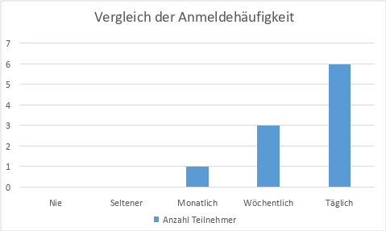
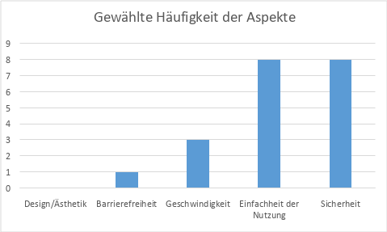
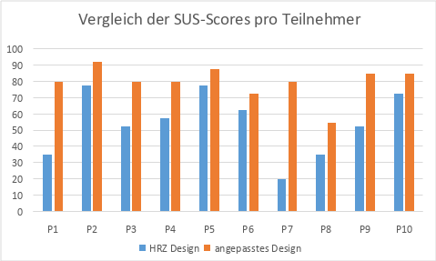

# Strukturvorschlag:
## Einleitung zum Kapitel
- Kurze Beschreibung, was in diesem Kapitel präsentiert wird.
- Hinweis auf die Struktur (z. B. erst Umfrageergebnisse, dann Usability-Tests).
## Ergebnisse der Umfrage
- Stichprobenbeschreibung (z. B. Alter, Geschlecht, IT-Kenntnisse der Teilnehmenden).
- SUS-Werte (ggf. Mittelwerte, Standardabweichung, Vergleich alter/neuer System).
- Ergebnisse zur 2FA (Antwortverteilung auf Fragen zu - Zwei-Faktor-Authentifizierung).
- Weitere relevante Ergebnisse (ggf. Korrelationen oder Muster in den Daten).
## Ergebnisse der Usability-Testings
- Vergleich altes vs. neues System (z. B. Usability Scores, subjektive Einschätzungen).
- Beobachtungen aus Think Aloud (Häufige Probleme, Verhaltensweisen, positive Aspekte).
- Quantitative Bewertung (Falls du numerische Usability-Werte gesammelt hast).
## Zusammenfassung der wichtigsten Ergebnisse
- Kurze Übersicht der zentralen Erkenntnisse, ohne Interpretation.

---
---
- eingehen auf die Studienergebnisse
- eingehen auf die Daten die erhoben wurden
- eingehen auf die Ergebnisse der Think Aloud Studie und des Interviews
    - Präsentation der Dinge die die Teilnehmer zu den Verbesserungsvorschlägen gesagt haben

# Auswertung der Fragebögen
- Ausschnitt aus der Demografik-Tabelle entwedrr hier oder in die Methods

Versuchsperson | Alter | Exp. Level | usw...
---------------|-------|------------|-------
P1             | ...   | ...        | ...
...            | ...   | ...        | ...

## Teilnehmer Stichprobe
- 6 Mitarbeiter, 4 Studenten, 1 Englischsprachiger, 6 Männlich, 4 Weiblich

#### // Alter
Rolle       | Min. | Max. | Median | Durschnitt | sigma
------------|------|------|--------|------------|------
Student     | 20   | 23   | 21     | 21.00      | 1,41
Mitarbeiter | 26   | 46   | 29     | 32.00      | 7,80
Zusammen    | 20   | 46   | 26     | 27,60      | 8,17

- muss dann auch mehr verwendet werden
- Studenten deutlich jünger und Alter weniger verteilt; alle im Bereich 20 und 23 Jahre
- Mitarbeiter älter und mehr verteilt über das Alterspektrum

#### // Experrience Level
- Tabellen braucht man nicht zwingend

Experience Level: | 1 | 2 | 3 | 4 | 5
------------------|---|---|---|---|--
Anzahl:           | 0 | 1 | 1 | 4 | 4

Kenngröße: | Min. | Max. | Median
-----------|------|------|-------
Werte:     | 2    | 5    |4

- auffällig hohe Erfahrungswerte; wurden ja Informatik Studenten und Mitarbeiter
    - Grund ist die Art der Rekrutrierung -> im Informatik Zentrum
- P2 Ausreißer nach unten, einziger Teilnehmer der weder Student noch Akademischer Mitarbeiter, sondern in der Verwaltung tätig ist, niedrigste IT Erfahrung mit 2

#### // Login Häufigkeit
- Grafik nicht nötig; Daten in die große Demografik Tabelle einpflegen

- im großen und ganzen benutzen Teilnehmer die Plattformen der Uni Bonn rgelmäßig
- 6 Teilnehmer benutzen tatsächlich täglich Platformen der Uni Bonn; 3 nur wöchentlich
- P10 tatsächlich nur monatlich
    - seltene Verwendung ging auch auch aus der Studien Sitzung

#### // 2FA
Zuletzt verwendete 2FA Methoden: | Keine | Papier TAN Codes | Push-Up-Benachrichtigungen | Sicherheitsschlüssel (z.B. YubiKey) | TOTP | E-Mail | SMS
---------------------------------|-------|------------------|----------------------------|-------------------------------------|------|--------|----
Anzahl:                          | 0     | 0                | 0                          | 1                                   | 7    | 8      | 8

- alle Teilnehmer schonmal von 2FA gehört
- alle angegeben, dass sie es im Alltag auch benutzen
    - P2 für Uni Account MFA freigeschaltet -> demententsprechend einem YubiKey Nutzer
- meisten in den letzten zwei Wochen SMS und Emails gefolgt von TOTP genutzt
    - deckt sich mit den Studien (Quelle?), die SMS und Emails als weit verbreiteste Methode sehen

#### // Anmeldemaske
- alle Teilnehmer mit der Nutzung der Shibboleth Anmeldemaske vertraut

Vertrautheit mit "Anmeldung nicht speichern" | 1 | 2 | 3 | 4 | 5
---------------------------------------------|---|---|---|---|--
Anzahl:                                      | 2 | 2 | 3 | 3 | 0

Kenngröße: | Min. | Max. | Median | Median Tägliche Nutzer | Median Wöchentlich oder seltenere Nutzer
-----------|------|------|--------|------------------------|-----------------------------------------
Werte:     | 1    | 4    | 3      | 3,5                    | 1,5

- Teilnehmer schienen tendenziell nicht mit der "Anmeldung nicht speichern" Funktion vertraut zu sein, obwohl Teilnehmer tendenziell wissen worum es gehen mag
- Nutzer, die sich täglich einloggen scheinen sich besser vertraut zu fühlen mit der Fubktion als wöchentliche oder seltenre Nutzer
    - tägliche Nutzer sehen diese Funktion täglich -> mehr vertraut
    - andere Nutzer sehen nicht so häufig -> weniger vertraut

- Sicherheit, Einfache Nutzung und schnelle Nutzung scheinen am wichtigsten zu sein
- niemand interessiert sich für das Design/Ästhetik
- Hinweise darauf, dass Teilnehmer einfach eine Funktional und nicht zwingend schön gestaltet Anmeldemaske wünschen

#### // SUS

Kenngröße:         | Min. | Max. | Median | Durschnitt | sigma
-------------------|------|------|--------|------------|------
HRZ Design         | 20   | 77,5 | 54,25  | 54,25      | 19,47
angepasstes Design | 55   | 95,5 | 80,00  | 79,75      | 10,24

- Verteilungen findet Christina cool
---
- im Diagram zu sehen ist, dass die SUS Scores überall größer sind
- erhebliche Unterschiede in der zentralen Tendenz
- sigma beim angepassten design kleiner -> Werte schwanken weniger
- ---
- Durchführung eines Hypothesentest: gepaarter zweiseitiger t-test:
    0. Hypothese H1 ist: Es gibt einen Unterschied in den Daten
        - H0: Es gibt keinen Unterschied in den Daten
    1. Shapiro-Wilk normality test: W = 0.87811, p-value = 0.1241
        - => t-test anwendbar, da p > 0.05
    2. Power Analyse durchfeführt:
        - Für n = 10, ein Cohens'd = 1.55, alpha = 0.05 kam eine Power von 0.99 heraus
        - Für eine Power von mindestens 0.8 wären mindestens 6 Teilnehmer nötig um den Effekt nachzuweisen
    3. Durchführung gepaarter, zweiseitiger t-test:
        - t = -4.91, df = 9, p = 0.00083 < 0.05
    => Der Unterschied in den SUS-Werten ist statistisch signifikant
        - können H0 verwerfen und H1 annehmen

---
---
# Demografik
- Mitarbeiter
- < demografik Statistiken einbauen >

- P4 fand Abläufe beim angepassten Design flüssiger und geschmeidiger aber es wären beide Designs, da sie funktioniert haben in Ordnung

## Studienergebnisse

## Beobachtungen
- Unklar wann der zweite Faktor dazu gepackt wird
- Begriffe wie YubiKey, Sicherheitsschlüssel nicht bekannt
    - viele Leute würde sich schwer tun, wenn sie das erste mal einen YubiKey nutzen müssten
    - => vorherige, kurze Schulung wäre sinnvoll
- P5 unsicher, das die MFA Abläufe auch auf den HRZ Seiten weitergehen können
- P4 & P5 zu anfang mit der Bedienung des Setups unsicher
- P5 wüsste nicht, was er in dem Fall, wenn der YubiKey nicht funktioniert machen sollte, wenn Aufgabe nicht gepromptet hätte, das man eine Supportanfrage stellen soll
- Probleme mit der Setup Bedienung
    - P5 hatte erhebliche Probleme bei der Bedienung des Setups
    - Unsicherheiten mit der Aufgabe, Setup Nutzung, 2FA Nutzung
- Hinweise, dass ältere Teilnehmer mehr vertraut mit klassichem, traditionellen Webseiten Design
- Teilnehmer versuchen über Passwort vergessen irgenwas zu finden um eine Supportanfrage zu stellen
- P7 hatte keine Probleme PW vergessen zu finden, hat diesen Prozess schoneinmal durchlaufen, deshalb er wusste wie man da hin kommt
    - deshalb er fand beide Verlinkungen gleich gut
- Teilnehmer verwirrt oder finden es unintuitiv, dass man auf das Tokenfeld klicken muss um die Simulation zu starten
- Teilnehmer schon von ersten Durchlauf gelernt, wo Supportanfrage steht
- Teilnehmer schauen wenn sie eine Supportanfrage stellen wollen nicht im Footer nach, sondern da wo Passwort vergessen steht
- Die Verlinkungen entsprechen nicht den Erwartungen der Benutzer beim HRZ Design
    - Ausdrücke wie "Ähh, u ähä"
- P8 mochte die verschaltete Führung der Seiten im HRZ Design nicht
- P9 trat der Bug, dass die Buttons nicht ausgegraut werden so start auf, dass Alex sich kurz ans Setup setzen musste, hat aber dann sofort wieder geklappt
- Hilfe benötigt fällt mehr ins Auge als die Supportanfrage im Footer selbst wenn Teilnehmer zuvor schon gelernt haben, dass dies im Footer ist
- Teilnehmer schauen auch bei anderen Problemen zuerst bei Passwort vergessen
- viele Teilnehmer aber auch aus dem Bereich UseCap sowohl Mitarbeiter als auch Studenten
- Benutzer finden PW steht allein, finden das komisch aber acknowledgen es da weil es gut sichtbar ist
- Eindruck, dass Teilnehmer benötigen beim ersten mal mehr Zeit beim HRZ Design
- P10 möchte unter alle umständen, wenn möglich unbedingt keinen YubiKey benutzen, weil er befürchtet, das er ihn verlieren, verlegen und vergessen würde
    - erwähnt dies mehrmals, wiederholt in der Studie
- Teilnehmer verstehen Relevanz des Tokenverfahren neu starten nicht
- Teilnehmer wissen nicht warum sie inhre Informationsweitergabe widerrufen sollten
    - suggeriert im angepassten Design, dass das wichtig sei
-  Informationsweitergabe völlig egal wollen nur die Dienste benutzen
- Teilnehmer tendieren bei YubiKey klappt nicht Aufgabe auf Tokenverfahren neu starten zu klicken ohne zu wissen was es tut
- eplorieren